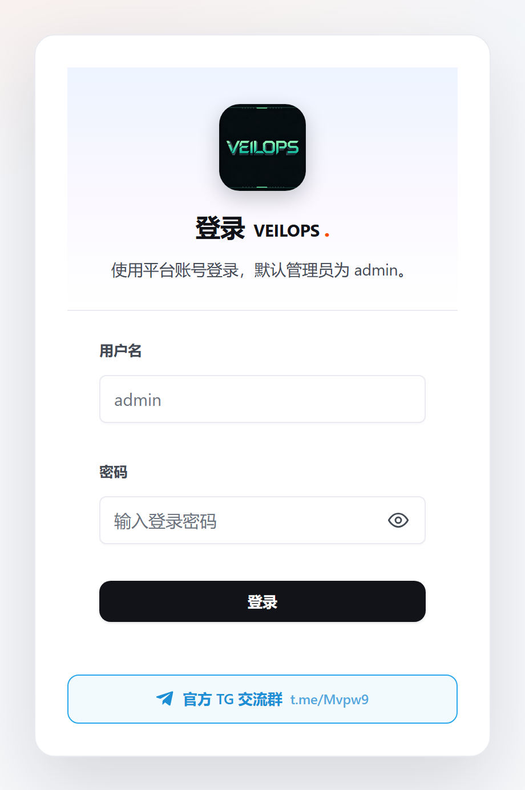
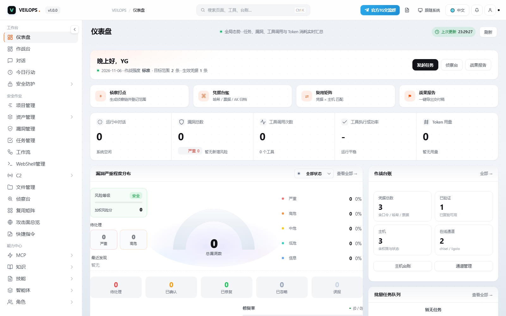
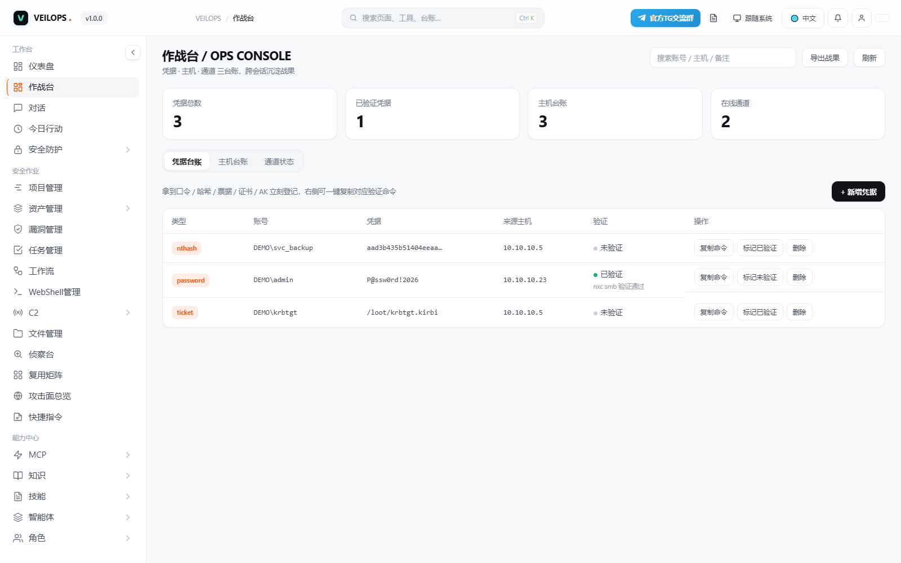
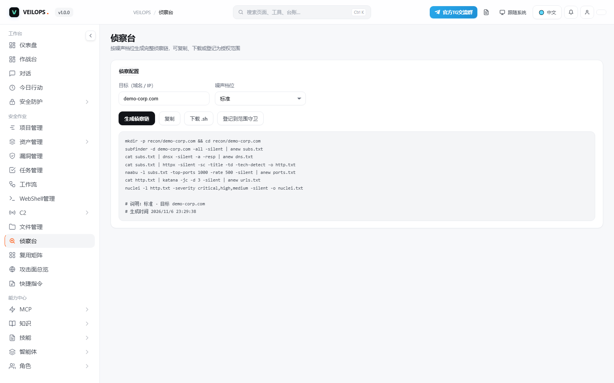
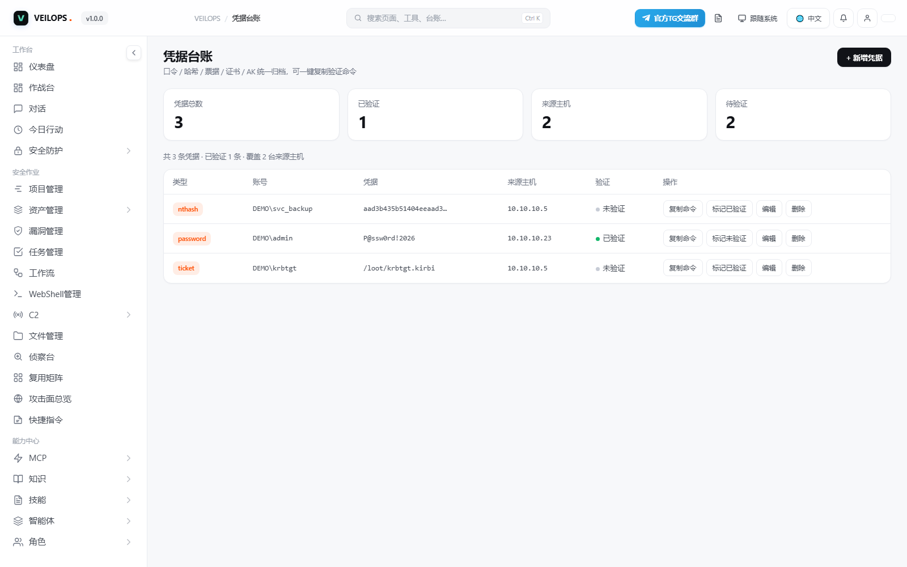

<p align="center">
  
</p>
# VEILOPS · AI Security Console

<p align="center">
  <a href="https://t.me/Mvpw9">
    
  </a>
</p>

> ## 📢 官方 TG 交流群
> ## 👉 [https://t.me/Mvpw9](https://t.me/Mvpw9)
>
> 安装卡住、版本更新、功能需求、授权范围怎么登记 —— 都可以在群里直接问。

> AI 驱动的安全作业控制台：侦察、打点、凭据台账、主机台账、隧道通道、C2 会话与战果报告收进一个界面，
> 由大模型按目标自动编排工具链，全程留痕、可审批、可导出交付稿。

---

## 安装（**不需要 Docker**）

程序是编译好的单文件可执行程序 + 静态资源，下载解压即用。

### Linux（一键）

```bash
curl -fsSL https://raw.githubusercontent.com/VEILOPS/veilops/main/install.sh | bash
```

- 自动下载、校验、解压到 `/opt/veilops`（非 root 则装到 `~/veilops`）
- 有 systemd 时自动注册为 `veilops` 服务并启动
- 首次启动会打印一次性管理员密码

自定义端口：`VEILOPS_PORT=18080 bash install.sh`

### Windows（一键，PowerShell）

```powershell
irm https://raw.githubusercontent.com/VEILOPS/veilops/main/install.ps1 | iex
```

装到 `C:\ProgramData\veilops`，后台启动。自定义端口：`.\install.ps1 -Port 18080`

### 手动安装

到 [Releases](../../releases) 下载对应平台压缩包，解压后直接运行：

```bash
./veilops -config config.yaml --http
```

```powershell
.\veilops.exe -config config.yaml --http
```

---

## 支持的平台

| 平台 | 包名 |
|---|---|
| Linux x86_64 | `veilops-v1.0.0-linux-amd64.tar.gz`（musl 静态，任何发行版可跑） |
| Windows x64 | `veilops-v1.0.0-windows-amd64.zip` |

---

## 界面预览

| 登录页 | 仪表盘 · 全局态势 |
|---|---|
|  |  |

| 作战台 · 凭据 / 主机 / 通道 | 侦察台 · 按噪声档位生成侦察链 |
|---|---|
|  |  |

| 凭据台账 · 一键复制验证命令 | — |
|---|---|
|  | |

---

## 能做什么

| 能力 | 说明 |
|---|---|
| 对话式作业 | 自然语言下达任务，模型自动选工具、串链路、追进度 |
| 工具库 | 150+ 工具配方（侦察 / 打点 / 凭据 / 提权 / 横向 / 数据 / 清理） |
| 技能与角色 | 29 个战术技能包、17 个作业角色，按场景自动加载 |
| 作战台账 | 凭据 / 主机 / 通道 三类台账跨会话沉淀，支持复用矩阵匹配 |
| 侦察台 | 按噪声档位生成完整侦察链，可下载为 `.sh` |
| 攻击面总览 | 按网段聚合主机、端口与权限状态 |
| 范围守卫 | 登记授权范围，工具执行前校验目标，越界直接拦截 |
| 作战强度 | 静默 / 标准 / 激进三档，静默模式拦截高噪声工具 |
| C2 管理 | 监听器、会话、任务、载荷、事件审计 |
| 漏洞管理 | 按严重度分级、状态流转与复测闭环 |
| 审批闸门（HITL） | 高风险动作人工确认，策略可配、记录可查 |
| 战果报告 | 时间线汇总 + 一键导出 Markdown（凭据自动脱敏） |

---

## 首次配置

1. 浏览器打开 `http://<IP>:8080/`，用日志里的 `admin` + 一次性密码登录，**立刻改密码**
2. **设置 → 基本设置**：填你自己的模型 `Base URL` / `API Key` / 模型名（支持 OpenAI 兼容协议）
3. **治理 → 范围守卫**：登记授权域名 / IP 段，勾选「强制范围校验」

配置文件在安装目录下的 `config.yaml`，改完重启服务生效。

---

## 数据与备份

| 路径 | 内容 |
|---|---|
| `<安装目录>/data/conversations.db` | 会话、消息、台账、设置（SQLite） |
| `<安装目录>/data/knowledge.db` | 知识库与向量索引 |
| `<安装目录>/config.yaml` | 平台配置（含模型 API Key，权限 600） |

```bash
# 备份
tar czf veilops-backup-$(date +%F).tar.gz -C /opt/veilops config.yaml data
```

---

## 常见问题

**Q: 启动后打不开 8080？**
云服务器安全组 / 防火墙放行端口；或换端口重装：`VEILOPS_PORT=18080 bash install.sh`。

**Q: 初始密码没记下来？**
重置：`/opt/veilops/veilops -config /opt/veilops/config.yaml -reset-admin-password`

**Q: 需要装 Docker 吗？**
不需要。这是单文件可执行程序，解压即跑。

**Q: 支持 ARM / macOS？**
当前发版是 Linux x86_64 与 Windows x64。ARM 版本在群里说一声，按需出包。

**Q: 杀毒软件报毒？**
安全工具类程序常被误报。可核对 Releases 里的 `SHA256SUMS` 校验值；生产环境建议放隔离机器。

---

## 授权与安全

闭源商业授权：可免费下载、自用、内部分发；**源码不随本项目分发**，禁止反向工程与对外再分发。完整条款见 [LICENSE](LICENSE)。

本平台会调用真实安全工具，**仅可用于你拥有明确书面授权的目标**。内置「范围守卫」是防误操作护栏，不是法律授权凭证。发现安全问题请按 [SECURITY.md](SECURITY.md) 私下联系。
